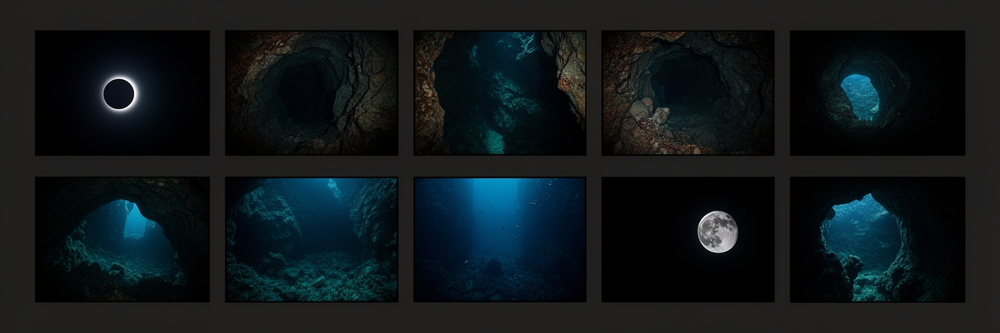

<p align="center">
  
</p>

# Dynamic Workspace Wallpapers for Ubuntu

> Formerly its own repository, now part of [linux_desktop_customization](https://github.com/olympus-terminal/linux_desktop_customization), which is the current setup.

Automatically switch wallpapers when changing workspaces in Ubuntu GNOME. Each workspace gets its own unique dark wallpaper.

## Features

- ✨ Different wallpaper for each workspace
- 🌙 Ultra-dark wallpapers (84-98% darkness)
- 🖥️ Optimized for Samsung Odyssey G9 (5120x1440)
- 🔄 Auto-corrects if wrong wallpaper appears
- 🚀 Can start at login; off by default because of a [freeze risk](https://github.com/olympus-terminal/linux_desktop_customization#desktop-freezes-when-switching-workspaces)

## Components

### Core Script
- `workspace-wallpapers.sh` - Main daemon that monitors workspace changes

### Tools
- `wallpaper_scraper.py` - Scrapes high-quality dark wallpapers from the web
- `analyze_wallpapers.py` - Analyzes images for darkness and resolution
- `darken_wallpapers.py` - Darkens bright wallpapers while preserving quality

### Configuration
- `workspace-wallpapers.desktop` - Auto-start configuration

## Installation

1. Clone this repository:
```bash
git clone <your-repo-url>
cd desktops
```

2. Run the wallpaper scraper to get dark wallpapers:
```bash
python3 wallpaper_scraper.py
```

3. Start the daemon:
```bash
./workspace-wallpapers.sh --daemon
```

4. Install the auto-start entry. It ships off; set `X-GNOME-Autostart-enabled=true` to enable it, accepting the freeze risk above:
```bash
mkdir -p ~/.config/autostart
cp workspace-wallpapers.desktop ~/.config/autostart/
```

## Usage

- **Start daemon**: `./workspace-wallpapers.sh --daemon`
- **Test detection**: `./workspace-wallpapers.sh --test`
- **Set current wallpaper**: `./workspace-wallpapers.sh --set-current`

## Customization

Edit the `WALLPAPERS` array in `workspace-wallpapers.sh` to use your own images:

```bash
WALLPAPERS[0]="file:///path/to/your/image1.jpg"
WALLPAPERS[1]="file:///path/to/your/image2.jpg"
# ... etc
```

## Requirements

- Ubuntu with GNOME
- `wmctrl` - Install with: `sudo apt install wmctrl`
- Python 3 with PIL/Pillow for the tools
- 11 workspaces configured in GNOME

## How It Works

1. Monitors workspace changes using `wmctrl`
2. Sets the appropriate wallpaper using `gsettings`
3. Continuously verifies the correct wallpaper is displayed
4. Auto-corrects if the wrong wallpaper appears

## Wallpaper Darkness Scores

Current wallpapers range from 84% to 98% darkness, perfect for reducing eye strain.

## License

MIT